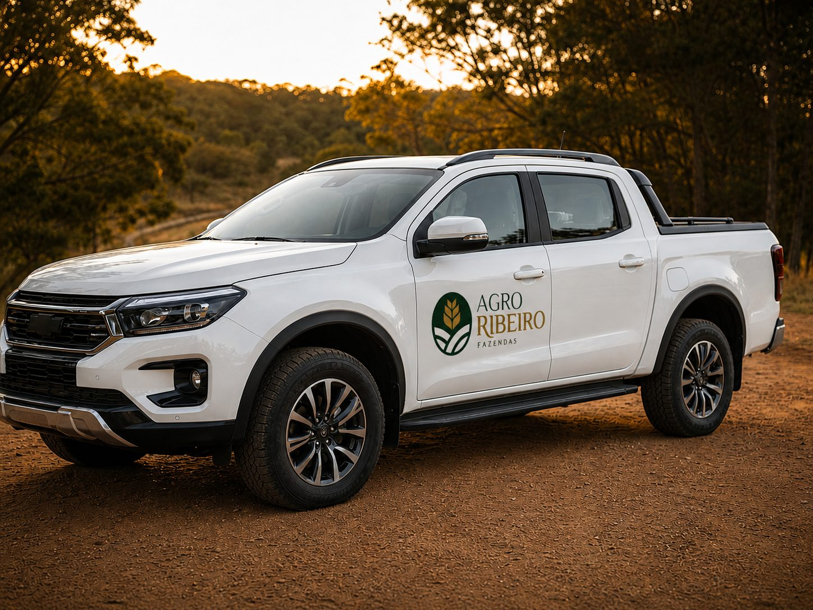

## Qual era a situação da Agro Ribeiro?

A Agro Ribeiro intermedeia fazendas de alto padrão. É um mercado em que a decisão de compra envolve valores altos e passa por histórico, documentação e avaliação técnica antes de qualquer visita ao terreno. O comprador não escolhe por impulso: ele precisa confiar antes de se mover.

Isso muda a pergunta do projeto. Não era "como parecer bonito", e sim "como parecer perito, e não corretor".

## O que o cliente precisava resolver?

Eram dois problemas, e o desafio foi resolver os dois juntos:

1. **Comunicar seriedade documental e rigor técnico**, na marca e no site, sem recorrer aos clichês visuais do agronegócio.
2. **Dar autonomia total ao cliente** para publicar novas fazendas no catálogo sem depender de um desenvolvedor a cada atualização.

Um site bonito que o cliente não consegue atualizar vira vitrine parada. Um site fácil de atualizar, mas com cara genérica, não passa confiança. A solução precisava das duas coisas.

## Que decisões guiaram a identidade visual?

A marca partiu de quatro pilares: **confiança, sofisticação, precisão e herança**. Cada escolha visual precisava responder a pelo menos um deles.

- **Um selo, e não um logotipo.** O símbolo é uma moldura oval que funciona como marca de autenticidade, a mesma lógica de um carimbo ou brasão. Dentro dela, uma espiga estilizada nasce de um único ponto, com folhas douradas se abrindo, e uma linha em creme na base representa o relevo do terreno.
- **Reconhecimento mesmo isolado.** O selo funciona como ícone de aplicativo, carimbo em couro ou bordado, e ancora a marca no território, em vez de usar um ícone genérico.
- **Paleta de verde-floresta, dourado, off-white e grafite**, para transmitir tradição sem pesar.
- **Tipografia com serifa editorial e apoio grotesco contemporâneo**, que une herança e precisão.
- **Um manual de marca**, que serve de referência única para qualquer fornecedor, seja a gráfica, a bordadeira ou a comunicação visual, para que o selo chegue idêntico a cada ponto de contato.

## Que decisões guiaram o site?

A pergunta técnica era: como dar ao cliente a autonomia de um CMS sem perder a velocidade de um site estático? Em geral, um CMS tradicional dá autonomia, mas pode ficar mais lento. Um site estático é rápido, mas muda pouco sem ajuda de quem programa. A combinação que atendeu aos dois pontos foi uma stack **headless**:

- **Astro**, que gera o site em páginas estáticas já prontas, o que favorece a velocidade e o SEO de cada página.
- **Sanity**, um CMS headless que dá ao cliente um painel dedicado para cadastrar, editar e publicar novas propriedades, sem tocar em código.
- **GitHub Actions**, que automatiza o caminho entre o painel e o ar: quando uma nova fazenda é publicada no Sanity, o site é reconstruído e publicado na Hostinger sem intervenção manual.

Em palavras simples: o painel onde o cliente escreve (Sanity) fica separado do site que o visitante vê (Astro). Cada parte faz o que faz melhor, e o automático liga as duas.

O conteúdo institucional, como a seção "O que verificamos", foi desenvolvido direto no código, para que as páginas fixas tenham o máximo de desempenho.

Repare que a promessa da primeira tela vem do mesmo raciocínio da marca: mostrar a checagem antes de mostrar o produto.

## O que mudou para o cliente?

- O cliente **publica novas fazendas direto no CMS**, sem depender de um desenvolvedor.
- Do clique em "publicar" até o site atualizado em produção, **o processo é automático**, sem etapas manuais.
- Cada página é gerada de forma estática, então **cada nova fazenda já nasce otimizada para velocidade e SEO**.

Para o cliente, a diferença aparece na rotina: cadastrar uma fazenda deixa de ser um pedido a um desenvolvedor e passa a ser uma tarefa interna, feita no próprio ritmo. Para o visitante, aparece na primeira impressão: páginas que abrem rápido e informação organizada.

Você pode ver o projeto completo no [case da Agro Ribeiro](/agroribeiro).

## O que eu levo para outros projetos?

1. **Comece pelas dúvidas que o cliente tem antes de comprar.** Se a decisão envolve valor alto, a primeira entrega do site e da marca é confiança, e não beleza.
2. **Decida a marca e o site juntos.** A promessa da identidade e a promessa do site precisam ser a mesma, ou o visitante percebe a quebra.
3. **Pense em quem vai atualizar o site depois.** Se cada mudança depende de um programador, o site tende a envelhecer. O mesmo vale para um escritório de advocacia, como explico em [O que um site de escritório de advocacia precisa ter para gerar contato](/blog/site-de-advocacia-que-gera-contato/).

Se o seu negócio vende algo em que a confiança vem antes do preço, é esse caminho que eu seguiria.
