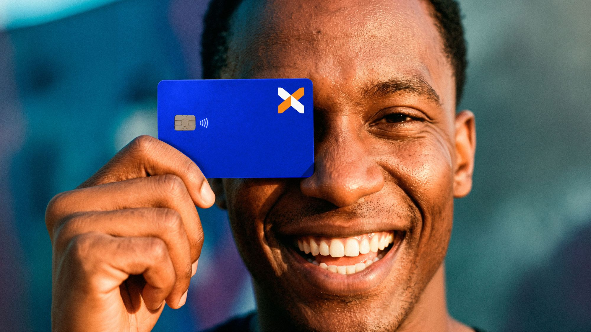
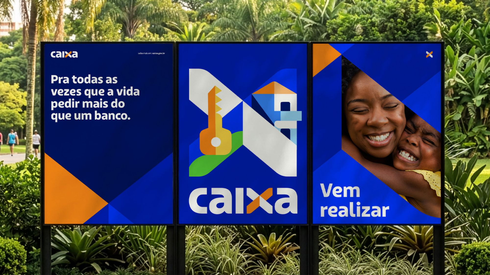
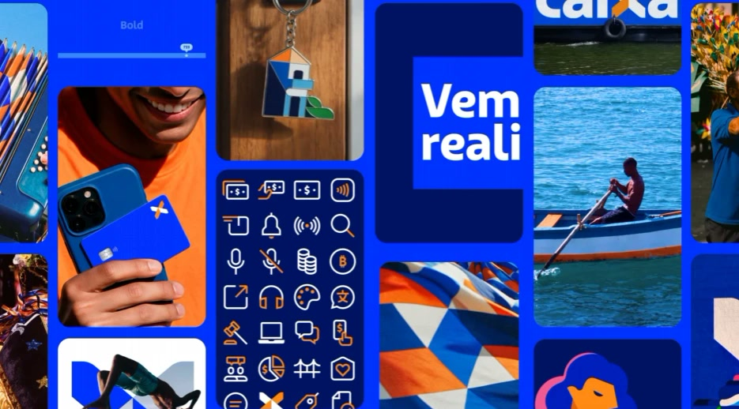
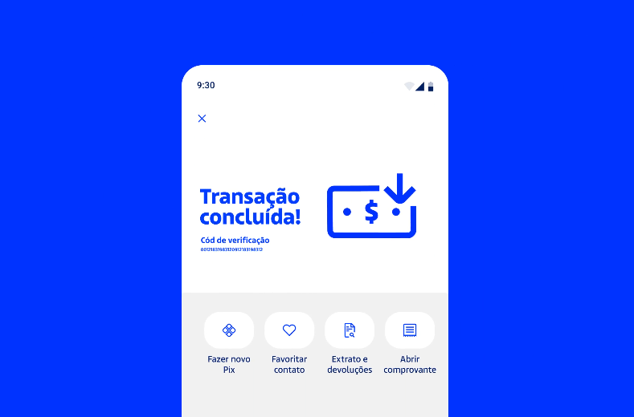

## Por que isso importa tanto?

A Caixa passou quase 30 anos sem uma grande atualização de marca. Segundo a Agência Brasil, a última mudança significativa foi em 1997, com o X azul e laranja, que sobreviveu às reformulações de 2005 e 2017. Em 9 de novembro de 2026, a Caixa apresentou a nova marca, e o projeto foi desenvolvido pela Tátil Design, segundo o Meio & Mensagem.

Pare para pensar no que isso significa. É uma marca presente no FGTS, na casa própria, nos benefícios sociais, na vida de quase todo brasileiro. Mexer nela é mexer na memória de milhões de pessoas. Por isso eu acho que este é um dos projetos de identidade mais importantes do ano, e vale olhar para ele como projeto, e não como notícia.

## O que eu acho que a Caixa acertou

**Evoluiu sem romper.** O estúdio diz que o X foi mantido e redesenhado, e que o azul ficou. Essa é, na minha leitura, a decisão mais inteligente do projeto. Uma marca com três décadas de reconhecimento é um patrimônio, e a pergunta certa não é "o que dá para jogar fora", e sim "o que as pessoas já associam a nós".

**Tinha uma ideia por trás.** Segundo o case, a Tátil partiu da união de opostos que sempre conviveram na marca, como social e comercial, necessidade e desejo. O estúdio descreve a Caixa como "o banco da necessidade", indispensável mas pouco desejável, e a ideia era levá-la de "única alternativa" a "alternativa única". Isso é relato do próprio estúdio, e eu o trato como tal. Mesmo assim, é um raciocínio que um dono de negócio pode copiar: uma frase que explica como você quer ser percebido.

**Pensou em sistema, não só em logo.** Segundo o case e as matérias, o trabalho inclui símbolo, cores, tipografia, ilustração, voz e a organização de mais de 50 projetos de marcas do ecossistema em um sistema integrado. É aqui que a maioria das marcas falha: o logo muda, e o resto continua parecendo de empresas diferentes.

## E os 3,5 milhões de reais?

Segundo o Valor, o projeto custou 3,5 milhões de reais entre 2024 e 2026, e foi mantido em sigilo total desde outubro de 2024. A matéria não detalha o que o valor cobre, nem se inclui a implantação, que a Caixa fará aos poucos nas agências, com previsão de terminar até 2030.

Eu sei que o número chama atenção, e o assunto rende discussão. Mas repare no que ele mostra: uma marca assim não é um desenho, é um projeto de anos, com decisões, testes, sistema e implantação. A ideia de que "logo é só um desenho bonito" é exatamente o que esse caso desmonta.

Um negócio pequeno não precisa desse orçamento, e eu seria o primeiro a dizer isso. O que ele precisa é do mesmo método, em escala proporcional. O que custa caro em uma marca nunca foi o traço, e sim a clareza sobre o que ela quer dizer.

## E as críticas nas redes?

Segundo o Estado de Minas, a reação foi mista: houve quem achasse a mudança necessária, depois de 29 anos, e houve piada, memes e comparação com título de novela. Uma internauta disse que a marca foi "gourmetizada". A reportagem não ouviu especialistas.

Minha leitura: toda troca de marca grande vira piada nos primeiros dias. Estranhamento mede familiaridade, e não eficácia. Marca se julga em meses e anos, no reconhecimento, no uso e na consistência, e por enquanto não há resultados publicados. Por isso eu não arrisco veredito sobre o sucesso. Minha opinião é sobre a decisão: ela foi bem tomada.

## O que um negócio pequeno pode levar

1. **Descubra o que já é seu.** Antes de mexer, saiba qual cor, forma ou nome o cliente já associa a você.
2. **Tenha uma frase central.** Como o negócio quer ser percebido? Cada escolha visual deve responder a isso.
3. **Dê um porquê a cada escolha.** Cor sem justificativa vira gosto pessoal.
4. **Pense em sistema.** Logotipo e versões, cores, tipografia, tom de voz e estilo de imagem, juntos.
5. **Implante por etapas.** Comece pelo que o cliente mais vê: site, perfis e assinatura de e-mail.

No [Barbosa Advogados](/barbosa), o projeto foi uma atualização de marca, e não a criação de uma identidade do zero. É o mesmo raciocínio em outra escala: preservar o que o escritório já tinha de reconhecível e atualizar o que precisava funcionar melhor.

## Quando isso não se aplica

Se a marca ainda não tem reconhecimento nenhum, não há o que preservar, e criar uma identidade nova, bem pensada desde o início, costuma ser o caminho mais simples. E se o seu logo já funciona bem em tela pequena e fundo escuro, talvez ele só precise de cuidado, e não de mudança. Se quiser entender a diferença, escrevi sobre isso em [Logo não é marca](/blog/logo-nao-e-marca/).
